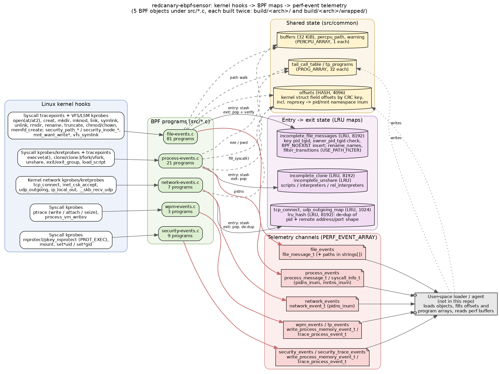

# redcanary-ebpf-sensor

This project consists of a variety of eBPF applications aimed at gathering events
of interest for [Red Canary's Linux EDR](https://redcanary.com/products/linux-edr/)
product.

These applications do not use [BCC](https://github.com/iovisor/bcc) to build. The
main objective of this design is to have a compile once, run everywhere application.

## Architecture

See [docs/architecture.md](docs/architecture.md) for the probes, BPF maps
and telemetry channels, with a diagram
([PNG](docs/diagrams/architecture.png), [SVG](docs/diagrams/architecture.svg),
Graphviz source [architecture.dot](docs/diagrams/architecture.dot)).



## Build

For building both x86_64 and aarch64 architectures (the image runs
`make dev`; the arm64 service needs Docker multi-platform emulation on an
x86_64 host):
`docker compose up`

To build either x86_64 or aarch64 architectures
`docker compose run --rm ebpf-amd64 make all`
or
`docker compose run --rm ebpf-arm64 make all`

Objects are written to `build/<arch>/` and `build/<arch>/wrapped/`
(the latter compiled with `-DCONFIG_SYSCALL_WRAPPER`).

> **Known issue:** the Docker image installs Ubuntu 22.04's default
> clang 14, which currently crashes (segfault) while compiling
> `src/file-events.c`; the other four objects build. Building on the host
> with clang 15 (`sudo apt-get install clang-15 llvm-15`, then
> `make CLANG_VER=15 dev`) produces all objects.

---

A vscode cpp properties file (`.vscode/c_cpp_properties.json`) has been
included. Make sure to update the include path with the path on your
local system where the kernel header files are located.

For convenience-sake, when running in a system with clang/LLVM installed
you can run `make dev` to build all of the eBPF programs into the
local `build/` directory (`make all` additionally runs `apt-get install`
for the toolchain and needs `sudo`). `make dev` uses the host's
architecture (`uname -m`); kernel types come from the bundled
`vmlinux_5_8_0_*.h` headers, not from the running kernel. Set
`CLANG_VER=<n>` to use versioned tools such as `clang-15` / `llc-15`.

If `build/<arch>/` already exists without a `wrapped/` subdirectory
(for example after `make test`), run `make clean` before `make dev`.

## Tests

Host-only tests (no kernel or BPF loading):

```bash
make test            # tests/test_security_events.c, tests/test_types.c
make test_file_maps  # compile-time checks in tests/test_file_maps.c
```

## Gotchas and Patterns

### Dummy Telemetry Event

At the beginning of the programs we often have code that looks like:

```c
process_message_t pm = {0};
```

We then proceed to send `&pm` to our functions and set the proper values there. This is done for two reasons:

1. We want to save stack space, so by creating a single dummy event at
   the top we can remind ourselves that this is the only event we ever
   want to have at a time and it is meant to be reused.

2. The eBPF verifier does not like uninitialized padding. When
   initializing a padded struct in C, not all of the space occupied by
   the struct necessarily gets initialized as padding may exist
   between fields, or empty space unused by some union members. The
   eBPF verifier does not like this so to guarantee nothing is
   unitialized we need to zero out all of the space for the event
   struct. For more information see [this
   issue](https://github.com/iovisor/bcc/issues/2623).

### Per CPU structures

Be careful when using PERCPU structures (such as
`BPF_MAP_TYPE_PERCPU_ARRAY`). While an eBPF program is not
preemptable, syscalls are. This means that a kprobe for a syscall may
happen in one CPU but its kretprobe will happen in a different
CPU. This means that passing data using per cpu structures accross
programs will not always work in multicore systems. Note, however,
that tail calling is *NOT* preemptable, so it is okay to pass
information using per cpu structures through tail calls.

### Multi-message events

Whenever possible a single event (i.e., syscall) should emit only a
single message during its `kretprobe`. You cannot have synchronizaiton
issues if there is only one message. When this is not possible we need
to be careful because syscalls may start and finish in different CPUs
(they are preemptable). All messages in the same program will be in
the same per-CPU buffer but messages for the same syscall but in
different non-tailcalled programs (e.g., `kprobe` vs `kretprobe`) will
not necessarily be put in the same per-CPU buffer which means
user-space may read them at different times. To avoid synchronization
issues all messages for a single event (i.e., syscall) should be sent
in the same `kretprobe` or tail calls from it and should share a
(unique enough) event id. Because they are all from the same probe we
can guarantee the order and thus not having to re-order events in
user-space. The event id is used as the identifier for user space to
know what messages to combine into the same event.

### Kretprobe not firing

Kretprobes are not guaranteed to fire so we cannot rely on it as a
cleanup strategy. Because of this our maps that send messages from
`kprobe` to `kretprobe`s are LRU maps such that any message that we
didn't clean up in a `kretprobe` will eventually be evicted.

## Validate Instruction Count

Due to older kernel limitations (< 5.2) the instruction limit for our
ebpf programs is 4096. This was changed in Kernel 5.2+ to be 1 million
but we cannot rely on that at this time. To verify that we aren't
going over the limit, after modifying an ebpf program run it through
`llvm-objdump` and check its instruction count:

```bash
llvm-objdump -d <PATH_TO_COMPILED_FILE> -j <SPECIFIC_SECTION_TO_ANALYZE> | less
```

You may ommit the `-j <SPECIFIC_SECTION_TO_ANALYZE>` if you want to
check all the sections at the same time.

eBPF programs can branch (but not jump back!) so make sure to check
that none of the branches go over the 4096 instructions limit.

# Development with clangd

If clangd is used as the LSP, compile commands can be easily generated with:

```bash
bear -- make dev
```

After that `clangd` should be able to pickup the created
`compile_commands.json`. A config exists in `.clangd` to further tweak
in case the compile commands are not enough for clangd to have a
successful build.

# Licensing

Please note, these programs are mostly licensed under GPL, which is
required to leverage BPF features critical for gathering security
telemetry.

```c
char _license[] SEC("license") = "GPL";
```

If you bundle these programs with your own code (for example, by using
`include_bytes!()` in Rust), that extends GPL to your code base.  If
you wish to use your own code with its own license alongside these
programs, you'll need to build, manage, and distribute them
separately.
