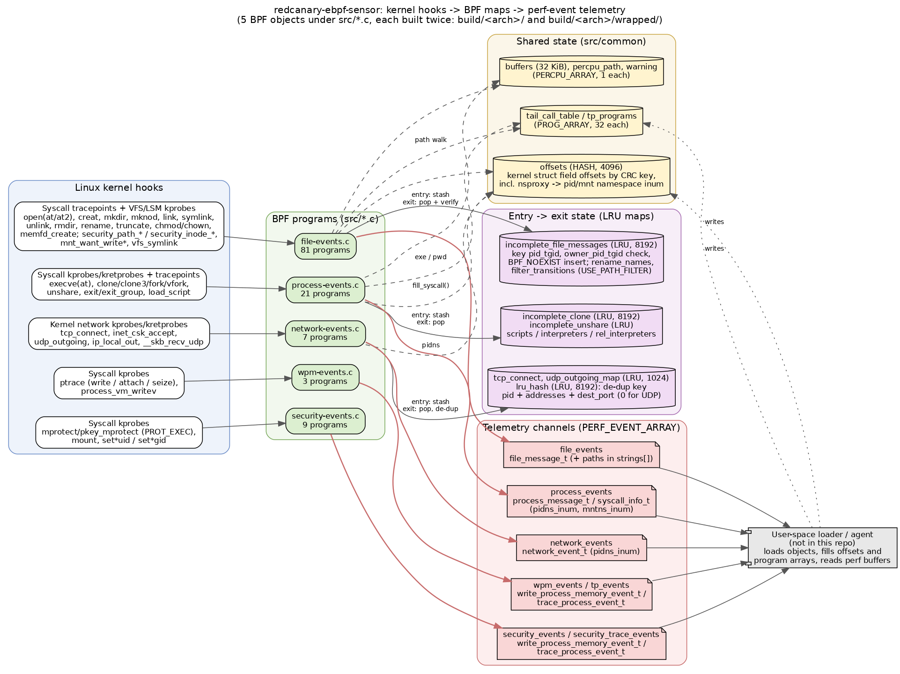

# Architecture

This document describes how the eBPF programs in this repository are
organised on the current default branch: which kernel hooks they attach
to, which BPF maps carry state between those hooks, and which perf-event
channels deliver telemetry to user space.



The diagram source is [`diagrams/architecture.dot`](diagrams/architecture.dot)
(Graphviz). An SVG render is in [`diagrams/architecture.svg`](diagrams/architecture.svg).
Re-render both after editing the source:

```bash
dot -Tpng -Gdpi=110 docs/diagrams/architecture.dot -o docs/diagrams/architecture.png
dot -Tsvg docs/diagrams/architecture.dot -o docs/diagrams/architecture.svg
```

## Scope

This repository contains only the kernel side of the sensor. Each
top-level `src/*.c` file compiles to one BPF ELF object. A separate
user-space loader (not in this repository; source comments refer to
`oxidebpf`) is expected to:

- load the objects and attach the `SEC("kprobe/...")`,
  `SEC("kretprobe/...")` and `SEC("tracepoint/syscalls/...")` programs
  that name real kernel hooks. Some sections are tail-call targets only
  and must go into a program array instead of being attached, e.g.
  `kprobe/exit_symlink` (`EXIT_SYMLINK`), `kprobe/sys_exec_pwd`
  (`SYS_EXEC_PWD`) and `tracepoint/filemod_paths` (`FILE_PATHS`);
- populate the `offsets` map with kernel structure field offsets;
- populate the `tail_call_table` and `tp_programs` program arrays;
- read the perf-event arrays and assemble telemetry.

Anything about that loader in this document is inferred from how the BPF
code uses the maps, not from loader source.

## Build outputs

`make dev` (or `make all`) compiles every `src/*.c` twice through
`clang -emit-llvm | opt | llvm-dis | llc -march=bpf`:

| Output | Flags | Use |
|---|---|---|
| `build/<arch>/<name>` | none | kernels without syscall wrappers |
| `build/<arch>/wrapped/<name>` | `-DCONFIG_SYSCALL_WRAPPER` | kernels whose syscall entry points take a wrapped `pt_regs` |

`<arch>` is `uname -m` inside the build environment (`x86_64` or
`aarch64`). Kernel types come from the bundled BTF dumps
`vmlinux_5_8_0_x86.h` / `vmlinux_5_8_0_arm.h` via `src/vmlinux.h`, not from
the build host's kernel headers. Field offsets that vary between kernels
are read at run time from the `offsets` map instead (see below).

## Source layout

| Path | Contents |
|---|---|
| `src/file-events.c` | 81 file-activity programs |
| `src/process-events.c` | 21 exec / clone / unshare / exit / script programs |
| `src/network-events.c` | 7 TCP / UDP programs |
| `src/wpm-events.c` | 3 ptrace / `process_vm_writev` programs |
| `src/security-events.c` | 9 `mprotect` / `mount` / `set*id` programs |
| `src/common/` | shared types (`types.h`), maps and `fill_syscall()` (`common.h`), offset keys (`offsets.h`), per-CPU buffer, path walking, warnings |
| `src/file/` | per-event-kind helpers for file events and `incomplete_file_messages` |
| `src/process/` | exec, clone, unshare, script helpers and `process_events` push |
| `tests/` | host-compiled layout and constant tests (no kernel needed) |

## Event pipelines

### File events (`file-events.c`)

1. A syscall-entry tracepoint (`sys_enter_open`, `sys_enter_rename`,
   `sys_enter_unlink`, ...) calls `enter_file_message()`, which inserts an
   `incomplete_file_message_t` into `incomplete_file_messages` keyed by
   `pid_tgid`.
2. LSM / VFS kprobes that run inside the syscall (`security_path_*`,
   `security_inode_*`, `security_file_open`, `mnt_want_write*`,
   `vfs_symlink`) add the target dentry, vfsmount and ownership data to
   that entry.
3. The syscall-exit tracepoint pops the entry, builds a
   `file_message_t`, walks the dentry chain into the per-CPU buffer
   (tail-calling through `tp_programs` / `tail_call_table` when the path
   is long) and emits it on `file_events`.

Hardening of `incomplete_file_messages` (`src/file/maps.h`):

- entries are inserted with `BPF_NOEXIST`, so a second entry for the same
  `pid_tgid` cannot overwrite one in flight;
- each entry stores `owner_pid_tgid`; on lookup a mismatch emits
  `W_PID_TGID_MISMATCH` and deletes the entry;
- a mismatch between the expected and stored event kind emits
  `W_KIND_MISMATCH` and deletes the entry;
- the map is an LRU hash (8192 entries), so entries whose exit probe never
  ran are evicted.

With `USE_PATH_FILTER`, `filter_transitions` drives an in-kernel path
filter; `rename_names` is per-CPU scratch for rename source names.

### Process events (`process-events.c`)

- **exec**: `sys_execve` / `sys_execveat` kprobes clear the caller's
  `scripts` entry; the `ret_sys_execve*` kretprobes (with `_pre_4_18`
  variants) emit the exec message. The executable path and working directory are built in the
  per-CPU buffer, using `tail_call_table` (`SYS_EXEC_PWD`) to stay under
  the instruction limit.
- **clone / fork**: `sys_clone`, `sys_fork`, `sys_vfork` kprobes and the
  `sys_enter_clone3` tracepoint store state in `incomplete_clone`
  (LRU, 8192); the matching return probes pop it and emit the child.
  `CLONE_THREAD` clones are ignored.
- **unshare**: `sys_enter_unshare` / `sys_exit_unshare` pair through
  `incomplete_unshare`.
- **exit**: `sys_enter_exit` and `sys_enter_exit_group` tracepoints.
- **scripts**: the `load_script` kprobe tracks interpreter use through
  `scripts`, `interpreters` and `rel_interpreters`.

All process telemetry goes to `process_events`. `fill_syscall()` in
`src/common/common.h` fills the common header (`syscall_info_t`): pid,
ppid, login uid, euid, egid, return code, monotonic timestamp, and the
PID and mount namespace inode numbers (`pidns_inum`, `mntns_inum`).

### Network events (`network-events.c`)

- `tcp_connect` / `ret_tcp_connect` pair through the `tcp_connect` map;
  `udp_outgoing` and `ip_local_out` store the `skb` in `udp_outgoing_map`
  for `ret_udp_outgoing` (LRU, 1024 each, keyed by thread id).
- `ret_inet_csk_accept` (inbound TCP) and `ret___skb_recv_udp` (inbound
  UDP) emit directly.
- `push_event()` drops events whose shape is already in `lru_hash`
  (LRU, 8192) and records the shape only after a successful
  `bpf_perf_event_output`. The key is `network_event_key_t`: pid, the
  `protos` address block (both addresses) and `dest_port` (`0` for UDP).
  For inbound TCP, `dest_port` is the local port.

Output is `network_event_t` on `network_events`, including `pidns_inum`.

### Write-process-memory events (`wpm-events.c`)

- `sys_ptrace_write`: write-style requests (`PTRACE_POKE*`,
  `PTRACE_SETREGS*`, ...), emitted as `write_process_memory_event_t` on
  `wpm_events`.
- `sys_ptrace`: `PTRACE_ATTACH` / `PTRACE_SEIZE`, emitted as
  `trace_process_event_t` on `tp_events`.
- `sys_process_vm_writev`: remote iovec addresses on `wpm_events`.

### Security events (`security-events.c`)

- `sys_mprotect`, `sys_pkey_mprotect`: emitted only when `PROT_EXEC` is
  requested, as `write_process_memory_event_t` on `security_events`.
- `sys_mount`, `sys_setuid`, `sys_setgid`, `sys_setreuid`,
  `sys_setregid`, `sys_setresuid`, `sys_setresgid`: emitted as
  `trace_process_event_t` on `security_trace_events`.

Each event carries a distinct `syscall_pattern_type_t` value (`SP_*`).

## Shared maps

| Map | Type | Size | Purpose |
|---|---|---|---|
| `offsets` | HASH | 4096 | kernel struct field offsets keyed by CRC constants in `offsets.h` (filled from user space) |
| `tail_call_table` | PROG_ARRAY | 32 | tail calls for exec path / pwd and symlink exit |
| `tp_programs` | PROG_ARRAY | 32 | tail calls into `filemod_paths` (`FILE_PATHS`) |
| `buffers` | PERCPU_ARRAY | 1 x 32 KiB | scratch space for variable-length strings |
| `percpu_path` | PERCPU_ARRAY | 1 | path-walk state shared across tail calls |
| `warning` | PERCPU_ARRAY | 1 | pending warning (`W_*` codes) attached to the next message |

Per-CPU maps are only safe to share within one program and its tail
calls; see "Per CPU structures" in the README.

## Namespace-aware PID tracking

`fill_syscall()` (process events) and `init_message()` (network events)
follow `task_struct->nsproxy` to the PID namespace for children and the
mount namespace and read their `ns.inum`. The offsets come from the
`offsets` map under `CRC_TASK_STRUCT_NSPROXY`,
`CRC_NSPROXY_PID_NS_FOR_CHILDREN`, `CRC_NSPROXY_MNT_NS`,
`CRC_PID_NS_NS_INUM` and `CRC_MNT_NS_NS_INUM`. The lookup is best effort:
if an offset is missing or a read fails, the field stays `0`, and the
event is still sent.

## Telemetry message types

All defined in `src/common/types.h` (the public header shared with user
space).

| Type | Channel(s) | Notes |
|---|---|---|
| `file_message_t` | `file_events` | `type` + union + trailing `strings[]` for paths |
| `process_message_t` | `process_events` | `type` + union (e.g. `syscall_info_t`) + trailing `strings[]` |
| `network_event_t` | `network_events` | protocol, addresses, ports, direction, process, `pidns_inum` |
| `write_process_memory_event_t` | `wpm_events`, `security_events` | common fields, target pid, up to `MAX_ADDRESSES` addresses |
| `trace_process_event_t` | `tp_events`, `security_trace_events` | common fields, target pid |
| warnings (`W_*`) | `file_events`, `process_events` | emitted as message types carrying `warning_info_t` |

## Tests

`make test` builds and runs `tests/test_security_events.c` (distinct
`SP_*` values, event struct layout) and `tests/test_types.c`
(`pidns_inum` / `mntns_inum` layout and namespace CRC keys). `make test_file_maps` syntax-checks
`tests/test_file_maps.c`, which asserts the `incomplete_file_message_t`
layout at compile time. None of these load programs into a kernel.
